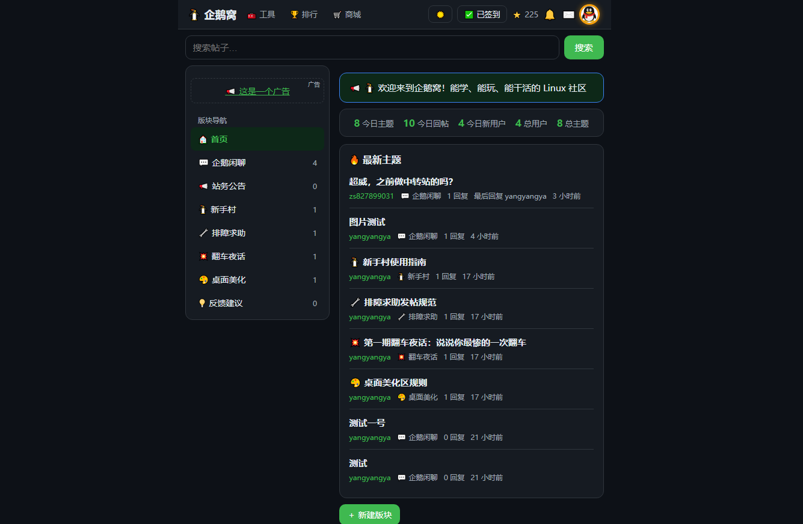
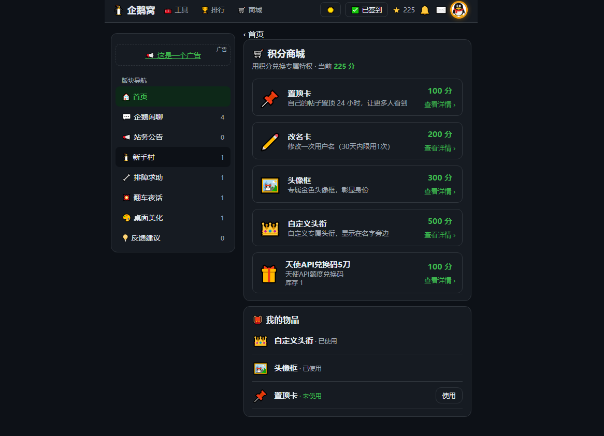
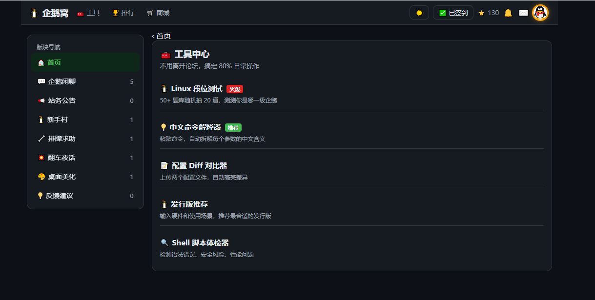

# 🐧 企鹅窝论坛


跑在 Cloudflare Workers + D1 上的轻量论坛。零依赖后端（纯 Workers 标准 API），前端纯原生 JS 单页应用。

[](https://deploy.workers.cloudflare.com/?url=https://github.com/xiaoyang123520/qiewo)

在线演示：https://linux.lblb.eu

## 📑 目录

- [📸 截图](#-截图)
- [✨ 功能](#-功能)
- [🚀 一键部署](#-一键部署)
- [📧 邮件服务（Resend）](#-邮件服务resend-注册与配置)
- [🛠️ 手动部署](#️-手动部署)
- [💻 本地开发](#-本地开发)
- [🔄 更新](#-更新)
- [📁 项目结构](#-项目结构)
- [🏗️ 架构](#️-架构)
- [🔌 API 概览](#-api-概览)
- [💰 成本](#-成本)
- [🤝 贡献](#-贡献)
- [📄 License](#-license)

## 📸 截图

| 首页 | 积分商城 | 工具中心 |
|------|----------|----------|
|  |  |  |

## ✨ 功能

**基础功能**
- 📝 版块 / 主题 / 回帖，分页、搜索（中英文）、多种排序
- 👤 注册登录（PBKDF2-SHA256 10 万次哈希）、邮箱验证、忘记密码
- 🛡️ Turnstile 人机验证、敏感词过滤、举报、禁言
- 🔔 通知、@ 提及、私信、点赞、收藏、引用（带楼层跳转）
- 🌙 暗色模式、History API 干净路径、sitemap.xml

**社区玩法**
- 📅 每日签到积分（北京时间，连续签到有加成）
- 🏆 排行榜（积分 / 发帖 / 回帖 / 活跃 × 总榜 / 月榜 / 周榜）
- 🛒 积分商城：置顶卡、改名卡、头像框、自定义头衔、卡密商品（后台可自助上架）
- 🎮 Linux 段位测试、中文命令解释器、配置 Diff、发行版推荐、Shell 体检

**管理后台**
- 📊 数据看板、用户管理、版块管理、举报处理
- 📢 广告位管理、友情链接管理、积分手动调整

## 🚀 一键部署

点击上方的 **Deploy to Cloudflare** 按钮，Cloudflare 会自动：

1. Fork 本仓库到你的 GitHub 账号
2. 创建 D1 数据库并执行所有迁移
3. 部署 Worker 到你的 `workers.dev` 域名

部署完成后，还需要在 Cloudflare 面板设置两个密钥：

| 密钥 | 说明 | 必填 |
|------|------|------|
| `RESEND_API_KEY` | Resend API Key，用于发送验证邮件 | 建议 |
| `TURNSTILE_SECRET` | Turnstile Secret Key，用于人机验证 | 建议 |

设置路径：Workers → cf-forum → 设置 → 变量和机密。

> 不设置也能跑，但注册时的邮箱验证和 Turnstile 验证会被跳过。

## 📧 邮件服务（Resend 注册与配置）

论坛用 Resend 发送注册验证邮件、密码重置邮件。按下面 4 步配置，全程免费。

### 步骤 1：注册 Resend

1. 打开 https://resend.com，点击 **Start Building**
2. 用 GitHub 或 Google 账号登录（推荐 GitHub，一键登录）
3. 登录后进入控制台

### 步骤 2：验证发件域名

Resend 不允许用没验证过的域名发信，必须先验证：

1. 控制台左侧点 **Domains** → **Add Domain**
2. 输入你的域名（如 `example.com`），点 Add
3. Resend 会给出 3 条 DNS 记录（SPF、DKIM、DMARC），去你的域名 DNS 服务商（Cloudflare/阿里云等）添加这 3 条
4. 回到 Resend 点 **Verify DNS Records**，一般几分钟内验证通过

> 没有自己的域名？Resend 提供测试域名 `onboarding@resend.dev`，只能发给注册 Resend 时用的那个邮箱，适合本地调试，不适合生产。

### 步骤 3：创建 API Key

1. 左侧点 **API Keys** → **Create API Key**
2. Name 随便填（如 `forum`），Permission 选 **Sending access**
3. 点 Create，**立即复制 Key**（只显示一次，格式 `re_xxxx`）

### 步骤 4：配置到论坛

```bash
# 设为 Worker 密钥（推荐方式）
npx wrangler secret put RESEND_API_KEY
# 粘贴刚才复制的 re_xxxx
```

发件地址在 `wrangler.toml` 的 `[vars]` 里改：

```toml
[vars]
FROM_EMAIL = "noreply@你的域名.com"  # 必须是步骤 2 验证过的域名
```

重新部署生效：

```bash
node build.js && npx wrangler deploy
```

### 免费额度

- 每天 100 封，足够中小论坛用
- 超出后 $0.001/封，按量付费

### 不想用 Resend？

把 `RESEND_API_KEY` 留空即可，论坛会自动跳过邮件验证环节（注册后直接可用）。适合内测或纯自用场景。

## 🛠️ 手动部署

### 1. 准备

```bash
git clone https://github.com/xiaoyang123520/qiewo.git
cd qiewo
```

### 2. 创建 D1 数据库

```bash
npx wrangler login
npx wrangler d1 create forum-db
# 把输出的 database_id 填进 wrangler.toml
```

### 3. 初始化数据库

```bash
npx wrangler d1 execute forum-db --remote --file migrations/001-init.sql
for f in migrations/00*.sql migrations/01*.sql migrations/02*.sql; do
  npx wrangler d1 execute forum-db --remote --file "$f"
done
```

### 4. 配置变量和密钥

在 `wrangler.toml` 的 `[vars]` 里填：
- `TURNSTILE_SITE_KEY`：Cloudflare Turnstile 的 Site Key
- `FROM_EMAIL`：发件地址，如 `noreply@yourdomain.com`

设置密钥：
```bash
npx wrangler secret put RESEND_API_KEY
npx wrangler secret put TURNSTILE_SECRET
```

### 5. 构建并部署

```bash
node build.js
npx wrangler deploy
```

### 6. 绑定自定义域名（可选）

Cloudflare 面板 → Workers → cf-forum → 设置 → 域和路由 → 添加自定义域。

## 💻 本地开发

```bash
node build.js
npx wrangler d1 execute forum-db --local --file migrations/001-init.sql
# 按顺序执行 migrations/ 下的其他文件
npx wrangler dev
```

访问 http://localhost:8787。第一个注册的用户自动成为管理员。

## 🔄 更新

上游仓库更新后，按你的部署方式二选一：

### 方式一：一键部署的用户

点部署按钮时 Cloudflare 会 fork 本仓库到你账号下，并开启推送自动部署。更新步骤：

1. 打开你 fork 的仓库页面，点 **Sync fork** → **Update branch**，把上游更新同步过来
2. 同步后 Cloudflare 自动重新部署（1-2 分钟）
3. **手动执行新增的数据库迁移**（这步不会自动跑）：

```bash
npx wrangler d1 execute forum-db --remote --file migrations/022-xxx.sql
# 只需执行上次更新之后新增的迁移文件，按文件名顺序
```

> ⚠️ 只拉代码不跑迁移，新功能用的表/字段不存在会报错。每次更新后去看 [migrations/](migrations/) 有没有新增文件。

### 方式二：手动部署的用户

```bash
cd qiewo
git pull

# 跑新增的迁移（按顺序，只跑上次之后新增的）
for f in migrations/022-xxx.sql; do
  npx wrangler d1 execute forum-db --remote --file "$f"
done

# 重新构建并部署
node build.js
npx wrangler deploy
```

### 如何知道有没有新迁移？

看 [migrations/](migrations/) 目录的更新时间，或看提交记录里有没有新增 `migrations/0xx-xxx.sql` 文件。没有新增就不用跑，直接部署即可。

## 📁 项目结构

```
src/
  worker.js     后端 API（路由、鉴权、D1 操作，约 1800 行）
  app.html      前端单页应用（约 2000 行原生 JS）
  cmd-db.js     中文命令解释器数据库
  quiz-db.js    Linux 段位测试题库
migrations/     D1 迁移脚本（按文件名顺序执行）
schema.sql      初始建表语句（同 migrations/001-init.sql）
build.js        构建脚本（内联前端 → dist/index.js）
wrangler.toml   Workers 配置
```

## 💰 成本

Cloudflare 免费额度内完全够用：
- Workers：每天 10 万次请求
- D1：每天 500 万行读取、10 万行写入、5GB 存储

日活几千的论坛都跑得动，不花一分钱。

## 🏗️ 架构

```
浏览器 (原生 JS SPA)
    ↓ HTTPS
Cloudflare Workers (worker.js)
    ↓ D1 Binding
Cloudflare D1 (SQLite)
```

- **零依赖**：后端只用 Workers 标准 API（`crypto.subtle` 做 PBKDF2、`fetch` 调 Resend/Turnstile），前端零框架
- **单文件部署**：`node build.js` 把前端内联进 Worker，打包成一个 `dist/index.js`
- **构建时注入**：命令数据库和题库在构建时注入到 HTML 的 `<script>` 开头，避免运行时请求

## 🔌 API 概览

| 方法 | 路径 | 说明 |
|------|------|------|
| POST | `/api/register` | 注册 |
| POST | `/api/login` | 登录 |
| GET | `/api/boards` | 版块列表 |
| GET | `/api/boards/:id/threads` | 主题列表 |
| POST | `/api/threads` | 发主题 |
| GET | `/api/threads/:id` | 主题详情+回帖 |
| POST | `/api/threads/:id/posts` | 回帖 |
| POST | `/api/checkin` | 签到 |
| GET | `/api/rankings` | 排行榜 |
| GET | `/api/shop/items` | 商城商品 |
| POST | `/api/shop/buy/:id` | 购买商品 |

完整接口见 `src/worker.js`。

## 🤝 贡献

欢迎提 PR！详见 [CONTRIBUTING.md](CONTRIBUTING.md)。

## 💡 反馈建议

有 bug 要报？有功能想要？**请到企鹅窝论坛的 [💡 反馈建议](https://linux.lblb.eu/b/7) 版块发帖**，站长亲自看、亲自回。

🎁 **一旦采纳，奖励 500 积分**，积分可在论坛商城兑换置顶卡、改名卡、头像框等道具。

> GitHub Issue 可能会漏看，论坛发帖必回。

## 📄 License

MIT
